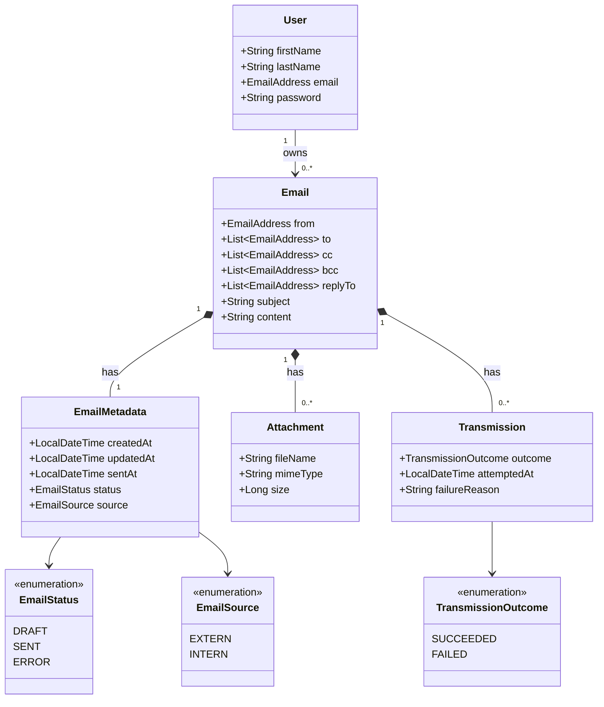
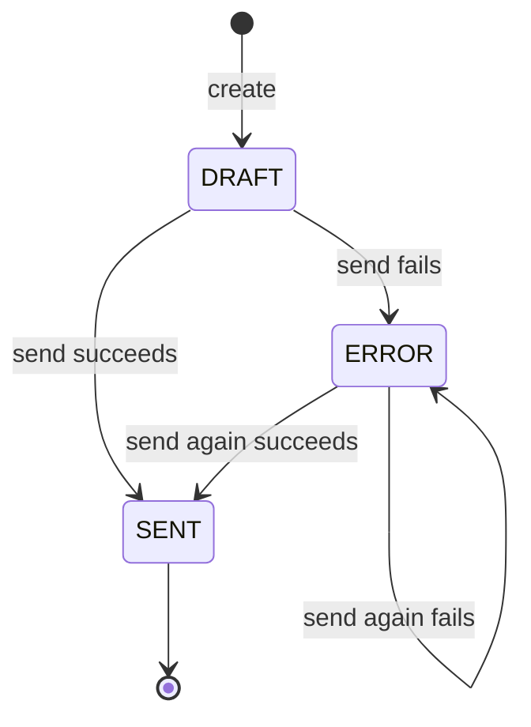

# Domain Model

This document describes the business domain of the email management system: domain objects, their properties, business rules, and workflows. It is a non-technical model. Technical information such as database IDs, storage paths, or password hashes is intentionally not part of it.

## 1. Domain Objects

| Object | Purpose |
|---|---|
| `User` | A person who can log in and manage emails. |
| `Email` | A message with recipients, subject, and content. |
| `EmailMetadata` | Read-only information about the life of an email (created, updated, sent, status, source). Separated from `Email` to keep it cohesive. |
| `Attachment` | A binary file belonging to exactly one email. |
| `EmailAddress` | A syntactically valid email address. |
| `EmailStatus` | Enum: `DRAFT`, `SENT`, `ERROR`. |
| `EmailSource` | Enum: `EXTERN` (received), `INTERN` (sent from this system). |
| `Transmission` | One attempt to send an email, with its outcome. An email can have several attempts. |
| `TransmissionOutcome` | Enum: `SUCCEEDED`, `FAILED`. |

Addition to the original description: every `Email` belongs to one `User` (its owner), because users must only see their own emails.

## 2. UML Class Diagram

## 3. Property Types

### User
| Property | Type | Required | Notes |
|---|---|---|---|
| firstName | String | yes | |
| lastName | String | yes | |
| email | EmailAddress | yes | unique across users |
| password | String | yes | only ever stored in protected form (see rule U3) |

### Email
| Property | Type | Required | Notes |
|---|---|---|---|
| from | EmailAddress | yes | |
| to | List&lt;EmailAddress&gt; | no | see rule E1 |
| cc | List&lt;EmailAddress&gt; | no | see rule E1 |
| bcc | List&lt;EmailAddress&gt; | no | see rule E1 |
| replyTo | List&lt;EmailAddress&gt; | no | |
| subject | String | yes | non-blank |
| content | String | yes | plain text, non-blank |

### EmailMetadata (read-only, controlled by the server)
| Property | Type | Required | Notes |
|---|---|---|---|
| createdAt | LocalDateTime | yes | |
| updatedAt | LocalDateTime | yes | initially equals createdAt |
| sentAt | LocalDateTime? | no | unset until the email was sent successfully |
| status | EmailStatus | yes | initially `DRAFT` |
| source | EmailSource | yes | |

### Attachment
| Property | Type | Required | Notes |
|---|---|---|---|
| fileName | String | yes | taken from the upload |
| mimeType | String | yes | taken from the upload, format `type/subtype` |
| size | Long | yes | size in bytes, taken from the upload |
| (binary content) | bytes | yes | the file itself |

### Transmission (read-only, controlled by the server)
| Property | Type | Required | Notes |
|---|---|---|---|
| outcome | TransmissionOutcome | yes | |
| attemptedAt | LocalDateTime | yes | |
| failureReason | String? | no | set if and only if the outcome is `FAILED` |

## 4. Business Rules

### EmailAddress
- **A1** Must match the pattern `local@domain` and must not contain whitespace.
- **A2** Maximum length is 254 characters.

### Email
- **E1** At least one address must exist in `to`, `cc`, or `bcc`.
- **E2** Each of the four lists has at most 50 addresses; `to`, `cc`, and `bcc` together have at most 100.
- **E3** A list must not contain the same address twice (case-insensitive).
- **E4** `subject` has 1 to 255 characters after trimming.
- **E5** `content` has 1 to 100 000 characters after trimming.
- **E6** An email with status `SENT` is read-only. Its fields and attachments cannot be changed.
- **E7** The client can never set metadata. The server controls it.

### EmailMetadata
- **M1** `updatedAt` is never earlier than `createdAt`.
- **M2** `sentAt` is set if and only if `status` is `SENT`.

### Attachment
- **F1** An email has at most 10 attachments.
- **F2** A single attachment has 1 byte to 10 MB; all attachments of one email together have at most 25 MB.
- **F3** `fileName` has 1 to 255 characters and contains no path separators (`/` or `\`).
- **F4** `mimeType` matches `type/subtype`.
- **F5** An attachment is never updated, only created, read, or deleted.
- **F6** Deleting an email deletes all its attachments.

### Transmission
- **T1** `failureReason` is set if and only if `outcome` is `FAILED`.
- **T2** Only an email with the source `INTERN` and the status `DRAFT` or `ERROR` can be sent. A rejected request records no transmission and changes nothing.
- **T3** A successful attempt sets the status to `SENT` and `sentAt` to the time of the attempt. A failed attempt sets the status to `ERROR`.

### User
- **U1** `firstName` and `lastName` have 1 to 100 characters each.
- **U2** `email` is a valid `EmailAddress` and unique.
- **U3** A password has 8 to 72 characters and is stored only as a salted hash.
- **U4** A user can only access their own emails.

## 5. Workflow: Email Status

- A `DRAFT` or `ERROR` email can be edited and sent.
- Every send attempt is recorded as a `Transmission` (rules T1 to T3).
- A `SENT` email never changes again (rule E6).
